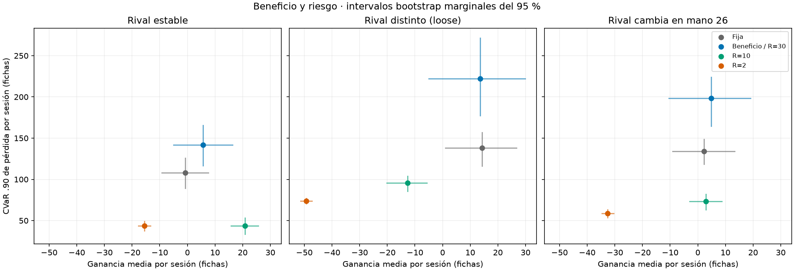
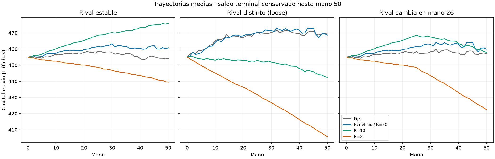

# Resultados ejecutados — 11 de octubre de 2026

Estudio principal: **3000 sesiones, 150000 manos**, 200 sesiones por cada una de
15 combinaciones; semillas 10000–10199; 32 escenarios por decisión; alpha=.90.
Piloto separado: 45 sesiones con semillas 100–102 y 8 escenarios. Se ejecutó además
una comprobación del generador de figuras con 30 sesiones pequeñas (semillas
500–501, S=2), sin ajustar parámetros con sus resultados.

## Beneficio y riesgo conjuntamente

Todas las cantidades salvo frecuencias se expresan en fichas. `Beneficio` es la
política sin restricción de riesgo. R=30 coincide con ella en este modelo.

| Rival | Política | Media sesión | Desv. típica | CVaR sesión | Pérdida | Drawdown medio |
|---|---|---:|---:|---:|---:|---:|
| changing | Fija | 2.20 | 79.69 | 133.80 | 49.0% | 82.23 |
| changing | Beneficio | 4.89 | 107.16 | 198.25 | 44.5% | 113.50 |
| changing | R=10 | 2.89 | 41.61 | 73.15 | 48.0% | 47.66 |
| changing | R=2 | -32.58 | 15.03 | 58.55 | 97.5% | 37.95 |
| changing | R=30 | 4.89 | 107.16 | 198.25 | 44.5% | 113.50 |
| loose | Fija | 14.27 | 89.59 | 138.20 | 48.5% | 98.75 |
| loose | Beneficio | 13.65 | 126.05 | 222.15 | 44.5% | 135.54 |
| loose | R=10 | -12.67 | 49.79 | 95.65 | 59.0% | 59.38 |
| loose | R=2 | -49.30 | 15.39 | 73.90 | 99.0% | 51.88 |
| loose | R=30 | 13.65 | 126.05 | 222.15 | 44.5% | 135.54 |
| stable | Fija | -0.81 | 58.50 | 108.10 | 48.5% | 52.92 |
| stable | Beneficio | 5.72 | 77.77 | 141.95 | 46.0% | 79.38 |
| stable | R=10 | 20.87 | 35.91 | 43.55 | 28.0% | 33.12 |
| stable | R=2 | -15.54 | 15.63 | 43.50 | 85.5% | 23.67 |
| stable | R=30 | 5.72 | 77.77 | 141.95 | 46.0% | 79.38 |

Las 3000 sesiones llegaron a 50 manos; no se observó ruina. No significa que su
probabilidad sea cero. Las pruebas separadas sí cubren capitales pequeños y final
anticipado. En cada celda la cola CVaR tiene masa equivalente a **20 sesiones**
y utiliza 20 observaciones ordenadas (los empates no cambian el valor).

## Qué permiten concluir estos datos

- Frente al rival estable, R=10 mejora la media respecto de fija en 21.68 fichas;
  intervalo normal emparejado aproximado 95%: [14.56,28.80]. Su CVaR observado
  baja de 108.10 a 43.55. Intervalos bootstrap de CVaR: fija [89.50,126.00],
  R=10 [33.60,53.05]. Es evidencia dentro de este diseño, no garantía poblacional
  ni una prueba corregida por todas las comparaciones realizadas.
- Con rival loose, R=10 pasa a media −12.67. Frente a fija la diferencia es
  −26.94, intervalo emparejado [−38.28,−15.60]. Reduce CVaR observado
  (95.65 frente a 138.20), pero pierde beneficio: el error de rival importa.
- Cuando el rival cambia, la diferencia media R=10 menos fija es 0.69, intervalo
  [−9.25,10.63]. No hay base para afirmar una ventaja media concluyente; sí se
  observa menor CVaR muestral (73.15 frente a 133.80).
- R=2 produce pérdidas medias en las tres condiciones. En estable, su CVaR 43.50
  es casi el mismo que 43.55 de R=10: endurecer riesgo local no aporta aquí una
  mejora clara de cola de sesión y sacrifica mucha media.
- La política sin límite no demuestra una ventaja media frente a fija en ninguna
  condición mediante estos intervalos emparejados. No vender «optimización» como
  sinónimo automático de superioridad.
- R=30 coincide con beneficio porque ninguna mano puede perder más de 30 en
  esta configuración. Se comprobaron las 600 parejas de sesiones correspondientes.
  Sus intervalos bootstrap pueden diferir ligeramente por distintas semillas de
  remuestreo: es ruido de remuestreo, no diferencia en ganancias. La figura usa
  la estimación de beneficio para representar ambas.

## Factibilidad y coste

No hubo emergencias ni excesos de CVaR **predicho local** en R=2,10,30. No es una
certificación de CVaR verdadero ni de sesión. Existe una acción de exposición
pequeña factible para R>=2 en cada estado alcanzable de esta ronda.
La referencia de beneficio excedió el umbral comparativo local 10 en 2671/10137
(estable), 3839/10674 (loose) y 3290/10390 (changing) decisiones. No es una
alternativa admisible bajo R=10. La referencia fija no calcula predicciones.

Demostraciones funcionales separadas, semilla 10000, S=32:

- R=0 contra estable: 50 decisiones, 50 emergencias; saldo J1 final 426.
- Fija contra J2 `minrisk` con mínimo 5: 50 decisiones optimizadas de J2,
  46 emergencias; saldo J1 final 546. El incumplimiento está visible, no oculto.

Tiempo principal medido: 815.19 segundos (13.59 minutos), sin contar la posterior
regeneración de figuras y auditoría. Decisiones optimizadas: medias por celda
aproximadamente 6.13–6.24 ms; el equipo y el caché afectan estas cifras.

## Referencia de exposición y validación

Con q enteros 0..30, p=(.3,.1,.6), R1<=50 y mu2>=5, la enumeración no encuentra
ningún equilibrio generalizado del juego finito. Es coherente con que J1 prefiere
q1=0 ante q2>0, mientras que J2 necesita min(q1,q2)>=15 para cumplir su mínimo.
No se extrapola a otras distribuciones ni al póker con información privada.
Consultar las correspondencias completas en `exposure.json` y la figura común.

Auditoría adicional: las 150000 filas cumplen contabilidad, reparto sin duplicados,
identidad de mazos entre estrategias, acciones legales y conexión optimizador/motor.
Se reprodujeron 30 sesiones (primera y última semilla de cada celda) con el código
final; coinciden acciones, estimaciones y saldos, excluyendo tiempos. Ver
[audit.json](../results/study/audit.json) y [alcance de pruebas](VALIDACION.md).

## Límites y siguiente estudio

Solo hay 3.2 escenarios equivalentes en la cola local de planificación y 20 en
cada cola de sesión evaluada. El rival es una regla artificial; se ignora el rango
condicionado por apuestas, no hay aprendizaje ni apuestas postflop y la continuación
propia difiere de volver a optimizar. No se ha demostrado estabilidad al aumentar S
ni N, optimalidad global, una cota de CVaR de sesión o rendimiento contra humanos.
Una ampliación defendible sería variar S con semillas nuevas y después incorporar
rangos condicionados; son trabajos pendientes, no capacidades entregadas.
La extensión exacta del informe queda pendiente de confirmación docente.

Tablas completas: [resumen](../results/study/summary.csv),
[incertidumbre](../results/study/uncertainty.csv),
[comparaciones emparejadas](../results/study/paired.csv),
[diagnósticos](../results/study/diagnostics.csv),
[manifiesto](../results/study/manifest.json).
